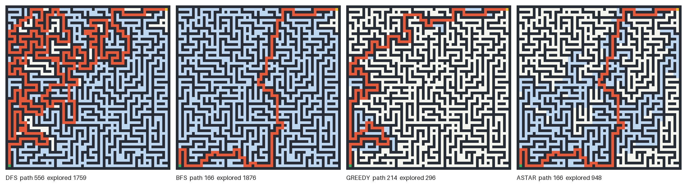

# PathFinding

Maze solving with four classic search algorithms: DFS, BFS, greedy best-first search and A*. It started as a small DFS script while I was going through search algorithms for an AI course. I later rewrote it so all four algorithms share one loop and can be compared on the same maze.



*Blue cells were expanded by the algorithm, red is the path it returned. Start is bottom left, goal top right.*

## What the comparison shows

On the 30x30 maze above (`mazes/large.txt`, generated with seed 3):

| algorithm | path length | cells explored |
|-----------|------------:|---------------:|
| DFS       | 556 | 1759 |
| BFS       | 166 | 1876 |
| Greedy    | 214 |  296 |
| A*        | **166** | **948** |

- **DFS** dives down one corridor until it hits a dead end. It finds *a* path, but here it's more than three times longer than necessary.
- **BFS** expands cells in order of distance from the start, so its path is always shortest. The price is that it looks at almost the whole maze.
- **Greedy** always expands the cell that looks closest to the goal. It's very fast here (296 cells), but it commits to a corridor that seems promising and ends up with a longer path.
- **A\*** ranks cells by *distance travelled + estimated distance left*. It returns the same shortest path as BFS while exploring about half as many cells.

The estimate is the Manhattan distance. On a grid where you can only move in four directions it never overestimates the real distance, and that's exactly the condition A* needs to guarantee a shortest path. The tests check this against a plain BFS on randomly generated mazes.

## Usage

```bash
pip install -r requirements.txt

python main.py mazes/maze1.txt                  # A* by default
python main.py mazes/maze1.txt --algo dfs --show
python main.py mazes/large.txt --compare --out images/comparison.png
python main.py --generate 40x40 --seed 1 --save mazes/big.txt --compare
```

Maze files are plain text: `#` is a wall, `A` the start, `B` the goal, anything else is free space.

## Structure

```
pathfinding/
  maze.py       loading mazes, neighbours
  search.py     the four algorithms (one loop, different frontiers)
  generate.py   random mazes (recursive backtracker + a few extra openings for loops)
  render.py     pictures with Pillow
main.py         command line
tests/          optimality and validity checks (pytest)
```

The random mazes start as "perfect" mazes, where there's only one route between any two cells. On those, every algorithm returns the same path, so a small fraction of walls is removed to create loops. That's where the algorithms start to differ.
